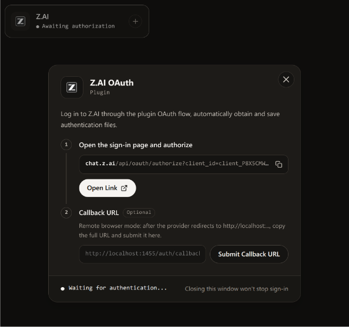
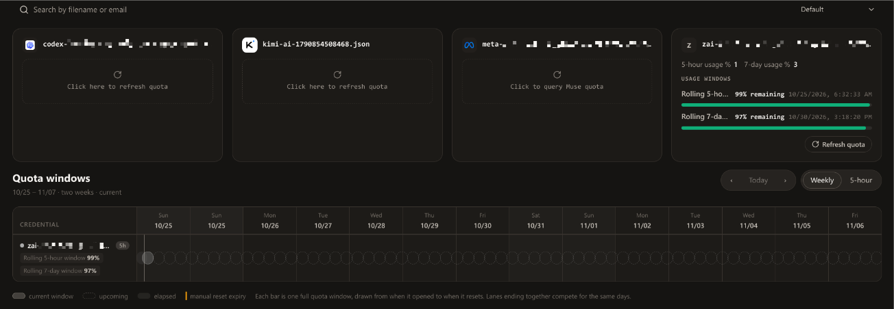

# cpa-auth-zai

A [CLIProxyAPI](https://github.com/router-for-me/CLIProxyAPI) plugin that adds z.ai (GLM Coding Plan) browser sign-in, account models, Chat Completions, OpenAI Responses, and Anthropic Messages execution, and quota/usage history. Login provisions a named project API key for inference; login-derived tokens remain separate for account APIs.

## Screenshots





## Build

[mise](https://mise.jdx.dev) provides Go and golangci-lint and runs the tasks (`mise run` lists them). All Go dependencies are vendored, including the public CPA v8.0.40 SDK packages. No CPA checkout or Go module download is needed; tasks use `-mod=vendor`.

```bash
mise run test   # go test -race ./...
mise run build  # dist/cpa-auth-zai.so
```

## Release builds

The tag workflow uses GoReleaser and Zig to build the c-shared plugin for Linux, macOS, and Windows on amd64 and arm64. Ubuntu builds the Linux and Windows targets; macOS builds the Darwin targets with native Clang. GoReleaser publishes the release. Archives contain the plugin library with version and target in its name, its generated C header, and this README. Rename the library to CPA's `cpa-auth-zai-v<version>` form when installing it. For a local snapshot on macOS, install Zig 0.14.1 and run `goreleaser release --snapshot --clean`.

## Install (Linux amd64)

Copy the library into CPA's plugin directory using the ID-version naming rule (`mise run install` does this; override the target with `PLUGIN_DIR=... mise run install`):

```
plugins/linux/amd64/cpa-auth-zai-v0.1.0.so
```

Enable it in `config.yaml`:

```yaml
plugins:
  configs:
    cpa-auth-zai:
      enabled: true
      # Optional IANA zone for usage history when the request omits timezone.
      history-timezone: Europe/Bucharest
      # Exact project API-key name to reuse or create during login.
      api-key-name: cpa-auth-zai
```

## Active features

| Capability | Detail |
|---|---|
| `auth_provider` | Remote-friendly sign-in via z.ai's hosted polling flow; credentials stored by CPA; renewal = sign in again. |
| `model_provider` | Live Coding Plan catalog from `api.z.ai/api/coding/paas/v4/models`, using the business token derived from OAuth login. No fixed-model fallback. |
| `executor` | Uses the provisioned project API key and optional `X-Zcode-Token`. CPA payload-format metadata selects Chat Completions (`/api/coding/paas/v4/chat/completions`), OpenAI Responses (`/api/v1/responses`), or Anthropic Messages (`/api/anthropic/v1/messages`, with `anthropic-version: 2023-06-01`). No client-specific routing or login-token fallback. Native Responses is live-verified with a completed tool call and `response.completed`; Anthropic Messages remains live-unverified. |
| `quota_provider` | Rolling 5-hour / 7-day windows from `api.z.ai/api/monitor/usage/quota/limit`; missing values stay unknown. Resets are provider-managed (unsupported). |
| `management_api` | `GET /v0/management/plugins/cpa-auth-zai/usage/history` — token usage history with explicit timezone handling. |

Streaming executor requests always send `stream: true` to z.ai, including when the input payload omits `stream` or sets it to `false`. Non-streaming requests keep their payloads unchanged.

Model inference sends ZCode client fingerprint headers for identity, platform, OS, timezone, session, and request tracing. The pinned identity is ZCode 3.10.2. The plugin does not inspect an installed ZCode client or create a device-identity file. These headers apply to inference only, not account APIs.

Plugin cards and the plugin-resource sidebar use the official z.ai SVG. General provider branding belongs to the management UI and is not configurable through the plugin API.

## Login

Start the flow from the CPA management UI (provider `zai`) and complete sign-in in your browser — the browser may be on any machine. If z.ai redirects to its hosted callback page, paste the complete callback URL into the CPA login modal. The plugin polls z.ai's hosted login endpoint; no callback port, desktop URI handler, or localhost redirect is required.

After sign-in, the plugin lists keys in the default organization and first project. It reuses the exact `api-key-name` match or creates that key, retrieves its secret, and stores the combined key in CPA credential storage. It never selects another key, rotates keys, or deletes keys. Existing credentials from older plugin versions need a new sign-in before inference. Changing `api-key-name` also requires a new sign-in to provision the selected name.

The key-management API is third-party evidence, not a published z.ai integration contract. z.ai now separates Standard and Coding Plan keys; check the created key's classification and billing behavior during live verification.

## Logging

OAuth and quota/usage success and failure events go through CPA's `host.log` RPC. Pending OAuth polls stay quiet. Credentials are redacted from upstream error details. The plugin does not create a log file; CPA controls log output.

## Status and evidence tiers

See [docs/compatibility.md](docs/compatibility.md) for the verified/unverified contract table before relying on any single behavior.

---

## License

[MIT License](LICENSE)
